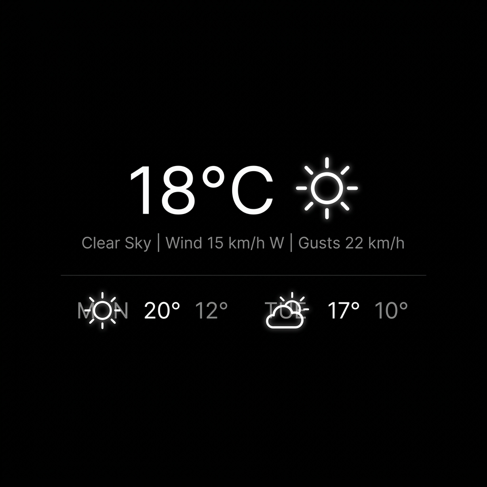

# mirrordash-weather

Weather forecast widget for MirrorDash. Displays current conditions and a configurable-length daily forecast strip using one of four weather provider APIs.

## Providers

| `provider` value | API | Free tier | API key required |
|-----------------|-----|-----------|-----------------|
| `"smhi"` | [SMHI Open Data](https://opendata-download-metfcst.smhi.se/) (`pmp3g/v2`) | Unlimited | ❌ No |
| `"open_meteo"` | [Open-Meteo](https://open-meteo.com/) | Unlimited | ❌ No |
| `"weatherapi"` | [WeatherAPI.com](https://www.weatherapi.com/) | 1 M calls/month | ✅ Yes |
| `"openweathermap"` | [OpenWeatherMap](https://openweathermap.org/api) | 1 000 calls/day | ✅ Yes |

**SMHI** is recommended for Sweden and the Nordics — no account or key required. **Open-Meteo** is recommended for global free use.

## Features
- Supports SMHI Open Data, Open-Meteo, WeatherAPI.com, and OpenWeatherMap APIs.
- Displays wind speed, precipitation, and multi-day daily forecasts.
- Weather warnings for the mirror's location under the current weather: SMHI's impact-based warnings (yellow, orange, red; its messages too if you choose) and WeatherAPI's alerts. Open-Meteo has none, OpenWeather only in its paid One Call API. **Weather Warnings** turns them off.
- Automatically reads coordinate, timezone, unit, and language settings from global configuration.

## Installation

On the mirror's admin page, open **Modules**: the module is in the list, install it with one click.
Or paste `git+https://github.com/Menturan/mirrordash-weather.git` under **Modules → Add modules → Install from a Git URL or folder**.

Developing it: `uv run pytest` runs its tests, and `uvx mirrordash-sdk validate .` checks it.

## Screenshot

## License
[MIT](LICENSE)
